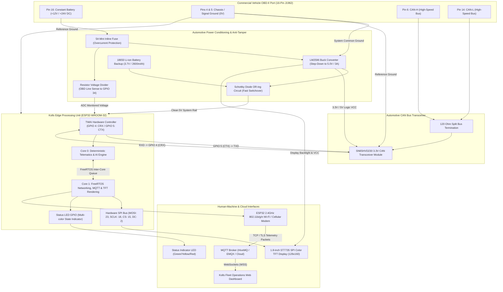

# Kolls Autotronics — AI Vehicle Health Monitoring System Architecture

> **Document Type:** Technical & System Architecture Specification  
> **Target Audience:** Engineering Team, Automotive Partners, Hardware Prototyping Engineers & Strategic Investors  
> **System Class:** Commercial Vehicle Edge Telematics & Predictive Anomaly Detection Platform  
> **Status:** Production Prototype Architecture (v1.0.0)

---

## 1. System Overview

### 1.1 Executive Summary
**Kolls Autotronics** is an edge-computing vehicle health monitoring and prognostic telematics system engineered specifically for commercial vehicle fleets, logistics trucks, and public transport operators in emerging markets such as Nigeria and Sub-Saharan Africa.

Commercial transport operators lose millions of Naira annually to undetected cooling failures, counterfeit fuel degradation, transmission thermal runaway, and unauthorized hardware tampering by drivers attempting to evade tracking. Traditional OBD-II trackers act merely as "dumb pipes", streaming raw coordinates or waiting for the vehicle’s Electronic Control Unit (ECU) to illuminate the Malfunction Indicator Lamp (Check Engine Light). By the time an OEM dashboard light illuminates, irreversible mechanical damage (e.g., blown head gaskets, cylinder scoring, warped engine blocks) has often already occurred.

Kolls Autotronics shifts intelligence directly to the vehicular edge:
1. **High-Frequency In-Situ Sampling:** Interrogates the vehicle's High-Speed CAN Bus (ISO 15765-4 / SAE J1939) at 10–50 Hz for mission-critical engine parameters.
2. **On-Device Edge AI & Heuristics:** Executes localized statistical anomaly detection, derivative thermal trend modeling ($dT/dt$), and fuel-trim divergence algorithms on an ESP32 dual-core microcontroller without requiring constant cloud connectivity.
3. **Anti-Tamper Failover Architecture:** Features an internal 18650 Li-ion battery backup and instantaneous voltage-drop detection circuit that transmits emergency distress telemetry even when the unit is forcibly ripped from the OBD-II port.
4. **Zero-Latency Telematics Stream:** Dispatches telemetry and pre-emptive failure alerts via MQTT/WebSockets to an interactive, responsive Web Dashboard featuring a modern "Liquid Glass" UI.

```
+---------------------------------------------------------------------------------------------------+
|                                      KOLLS AUTOTRONICS ECOSYSTEM                                  |
|                                                                                                   |
|   +-----------------------+         +--------------------------+         +--------------------+   |
|   |   Commercial Vehicle  |         |  Kolls Edge Hardware     |         | Cloud & Dashboard  |   |
|   |  - 12V/24V Electrical |  OBD-II |  - Dual-Core ESP32       |  MQTT   |  - HiveMQ Broker   |   |
|   |  - HS-CAN (500 kbps)  | =======>|  - SN65HVD230 Transceiver| =======>|  - Liquid Glass UI |   |
|   |  - Engine Sensors     |         |  - Edge Anomaly Engine   | (Wi-Fi/ |  - Live Gauges     |   |
|   |                       |         |  - 18650 Tamper Failover |  Cell)  |  - Instant Alerts  |   |
|   +-----------------------+         +--------------------------+         +--------------------+   |
+---------------------------------------------------------------------------------------------------+
```

---

## 2. Hardware Architecture

### 2.1 Physical Prototype Subsystems & Interconnects
The prototype hardware integrates automotive power conditioning, physical-layer CAN transceivers, human-machine interface (HMI), and backup power into an ultra-compact, vibration-resistant footprint:

1. **Power Regulation:** Stepped down from raw vehicle voltage (12V passenger / 24V commercial) using a high-efficiency LM2596 DC-DC step-down switching regulator, protected by an inline 5A fast-blow automotive fuse and transient protection diodes.
2. **Controller Area Network (CAN) Transceiver:** The Texas Instruments SN65HVD230 converts differential CAN High and CAN Low voltages to 3.3V logic levels for the ESP32 Two-Wire Automotive Interface (TWAI) peripheral.
3. **Core Processing Unit:** ESP32-WROOM-32D running FreeRTOS with dual Xtensa 32-bit LX6 cores operating at 240 MHz.
4. **Local Visual Diagnostics:** A 1.8-inch ST7735 color TFT display driven via high-speed SPI delivers instant in-cabin health status to drivers and maintenance technicians.
5. **Anti-Tamper Power Circuit:** An isolated 18650 Li-ion battery backup connected via a low-dropout Schottky diode OR-ing circuit with hardware ADC voltage monitoring for instant OBD unplug detection.

---

### 2.2 Signal Flow & Power Distribution Diagram



---

### 2.3 Component Bill of Materials (BOM)

The prototype BOM was strictly curated to balance industrial-grade automotive reliability with market-leading affordability in Nigeria:

| # | Component Name | Technical Specification | Primary Function in Architecture | Unit Cost (₦ NGN) | Source / Availability |
|---|---|---|---|---|---|
| **1** | **ESP32 Microcontroller** | ESP32-WROOM-32D (Dual-Core 240MHz, 520KB SRAM, 4MB Flash) | Edge anomaly detection, FreeRTOS dual-core tasks, CAN/TWAI & Wi-Fi | **₦11,000** | Lagos / Local Tech Market |
| **2** | **1.8" TFT Color Screen** | ST7735 Controller, 128x160 Resolution, SPI 4-Wire Interface | In-vehicle driver HUD, boot diagnostic screen, real-time alert banners | **₦5,000** | Electronics Component Vendor |
| **3** | **SN65HVD230 Transceiver** | 3.3V High-Speed CAN Transceiver, ESD protection, up to 1 Mbps | Translates differential CAN-H/CAN-L to 3.3V TTL for ESP32 TWAI | **₦2,500** | Automotive Parts / Robotics Store |
| **4** | **LM2596 DC-DC Step-Down** | High-Efficiency Step-Down Buck Regulator (3.2V–40V In to 1.25V–35V Out) | Steps down noisy 12V/24V vehicle battery to regulated 5.0V DC | **₦2,500** | Standard Hardware Importer |
| **5** | **OBD-II 16-Pin Male Plug** | Right-Angle / Straight 16-Pin J1962 Male Plug with 30cm Shielded Harness | Physical tap into commercial vehicle diagnostic port | **₦3,500** | Automotive Tools Vendor |
| **6** | **18650 Battery Case & Cell** | 3.7V 2600mAh Li-ion 18650 Cell + High-Impact Single-Slot Holder | Powers the ESP32 during anti-tamper OBD-II disconnect events | **₦1,000** | Battery Wholesale Depot |
| **7** | **Electrical Box Enclosure** | Flame-retardant ABS Junction Enclosure (IP54 Dust/Splash Proof) | Protects circuitry from engine bay heat, dust, and physical vibration | **₦1,000** | Electrical Enclosure Market |
| **8** | **Mini Inline Fuse Holder** | Inline waterproof automotive fuse holder + 5A Fast-Blow Blade Fuse | Protects against vehicular overcurrent spikes and alternator surges | **₦400** | Auto Electric Parts Market |
| **9** | **Status Indicator LED** | 5mm Ultra-bright Bi-Color / Tricolor RGB LED + 330Ω Resistors | Instant peripheral status (Green: Normal, Yellow: Alert, Red: Tamper) | **₦600** | Electronics Vendor |
| **10** | **Wires, Diodes & Resistors** | 22 AWG automotive silicone wire, SS34 Schottky diode, 100k/10k divider | Signal routing, power distribution, and voltage sensing | **₦500** | Workshop Stock |
| **11** | **Industrial Glue Stick & Mounts** | High-temperature hot melt adhesive & PCB nylon mounting standoffs | Vibration damping and mechanical strain relief inside enclosure | **₦400** | Local Hardware Vendor |
| **12** | **Procurement Logistics** | Intra-state delivery & logistics for physical component sourcing | Procurement overhead | **₦1,500** | Local Dispatch |
| | **TOTAL ESTIMATED PROTOTYPE BOM** | | | **~₦29,900** | *(Base target: ~₦25,900+)* |

> [!TIP]
> **Production Scaling Economics:** In commercial production batches of 1,000+ units, custom four-layer integrated PCBA manufacturing reduces the BOM to under **$12.50 USD (~₦19,000 NGN)** per unit.

---

## 3. Software Architecture

### 3.1 ESP32 Firmware Stack Architecture

The firmware is designed from the ground up on FreeRTOS to guarantee strict temporal separation between deterministic CAN bus frame acquisition and non-deterministic cloud/display operations.

```mermaid
flowchart TD
    subgraph Presentation_Layer["Presentation & HMI Layer"]
        UI_SPLASH["Boot Splash Screen (Kolls Brand & HW Self-Test)"]
        UI_GAUGES["Real-Time Metric Cluster (RPM, Coolant, Oil, Voltage)"]
        UI_ALERT["High-Visibility Emergency Warning Banner (Audio/Visual)"]
        LED_STATE["Tri-State LED State Machine (Normal / Warn / Critical / Tamper)"]
    end

    subgraph Application_Layer["Edge Intelligence & Application Layer"]
        ANOMALY["Edge AI Anomaly Engine (Z-Score & Derivative Rate-of-Change Analysis)"]
        TAMPER["Anti-Tamper Supervisory Routine (Power Loss & Unplug Watchdog)"]
        AGGREGATOR["Telemetry State Aggregator (Health Index Calculator)"]
    end

    subgraph Middleware_Layer["Middleware & Protocol Layer"]
        PID_PARSER["OBD-II PID Engine (Mode 01 Standard + J1939 Frame Parsing)"]
        RING_BUF["Circular Moving Average & EMA Sliding-Window Buffer"]
        JSON_SER["ArduinoJson 6/7 Serialization & Buffer Recycling"]
        MQTT_CLIENT["PubSubClient / ESP-MQTT Protocol Client (QoS 0/1, Keep-Alive)"]
    end

    subgraph Hardware_Abstraction["Hardware Abstraction Layer (HAL) & Drivers"]
        TWAI_DRV["ESP32 TWAI / SJA1000-Compatible CAN Driver"]
        SPI_DRV["Adafruit ST7735 Hardware SPI Display Driver"]
        WIFI_STACK["Espressif LwIP TCP/IP Stack & 802.11 b/g/n Wi-Fi Driver"]
        ADC_DRV["Hardware ADC1 Attenuation & Calibration Driver"]
    end

    %% Downward & Upward Invocations
    Hardware_Abstraction --> Middleware_Layer
    Middleware_Layer --> Application_Layer
    Application_Layer --> Presentation_Layer
```



---

### 3.2 Web Dashboard Architecture

The Kolls Fleet Dashboard is built as an ultra-responsive, zero-latency single-page application (SPA) optimized for fleet dispatch centers. It utilizes a **Liquid Glass** aesthetic (translucent glassmorphism with dynamic backdrop blur and responsive automotive dials).

#### Key Dashboard Components:
1. **MQTT.js WebSocket Engine:** Establishes a persistent, bi-directional `wss://` socket directly to the broker. Features automatic backoff reconnection, heartbeat monitoring, and instant payload deserialization.
2. **Dynamic Gauge Cluster:** Bespoke SVG circular dials representing engine RPM (0–7000 RPM) and vehicle speed (0–200 km/h) with CSS glow filters that transition dynamically from Emerald Green (`#00e676`) to Amber Alert (`#ffab00`) and Crimson Critical (`#ff1744`).
3. **Chart.js Multi-Axis Trend Visualization:** Renders 60-second rolling telemetry graphs displaying correlated trends:
   - *Thermal Correlation:* Engine Coolant Temperature (ECT) vs. Engine Oil Temperature (EOT).
   - *Combustion Efficiency:* Short-Term Fuel Trim (STFT) vs. Long-Term Fuel Trim (LTFT) vs. Intake Air Temperature (IAT).
   - *Electrical Health:* Alternator charging voltage stability curve.
4. **Instant Anomaly & Tamper Banner:** In-memory alert dispatcher that triggers modal warnings and browser notifications within <200ms of an anomaly packet arriving from the vehicle.
5. **Direct MQTT Broker Integration (No Prototype Backend Bottleneck):** For extreme low latency and rapid deployment, the web application connects directly to the MQTT message broker over WebSockets, bypassing intermediate server serialization overhead.

---

## 4. Data Flow & MQTT Schema

### 4.1 End-to-End Data Pipeline
1. **Request:** ESP32 Core 0 broadcasts standard OBD-II diagnostic query PID `0x7DF` requesting Mode 01 parameters (e.g., PID `0x0C` for RPM, PID `0x05` for Coolant).
2. **Capture:** The vehicle ECU responds on `0x7E8` through `0x7EF`. The hardware TWAI driver triggers a receiver FIFO interrupt.
3. **Parse & Filter:** Core 0 decodes raw hex bytes using OEM formulas, stores values in a sliding window ring buffer, and computes exponential moving averages (EMA).
4. **Evaluate:** The Edge Anomaly Engine checks thresholds, rate-of-rise ($dT/dt$), and multi-variable correlations. If an anomaly or tamper event occurs, status flags are immediately updated.
5. **Queue & Package:** Metric snapshots are forwarded via FreeRTOS queue to Core 1, which serializes the payload into a compact JSON document.
6. **Publish:** Core 1 publishes the packet to `kolls/vehicle/telemetry` (or `kolls/vehicle/alerts`) over MQTT.
7. **Broadcast:** Fleet dashboard clients subscribed to the topic receive the WebSocket frame, deserialize the JSON, update dials, append chart points, and raise alerts.

---

### 4.2 MQTT Topic Architecture

| Topic Pattern | Direction | QoS | Purpose | Frequency |
|---|---|---|---|---|
| `kolls/vehicle/telemetry` | Edge $\rightarrow$ Cloud | QoS 0 | Continuous health metrics, temperatures, RPM, voltages | 1 Hz – 5 Hz |
| `kolls/vehicle/alerts` | Edge $\rightarrow$ Cloud | QoS 1 | Immediate notifications of thermal runaway, fuel trim faults, or tamper events | Event-driven (<100ms) |
| `kolls/vehicle/commands` | Cloud $\rightarrow$ Edge | QoS 1 | Remote PID configuration, sampling rate adjustment, diagnostic resets | As needed |

---

### 4.3 Telemetry JSON Schema

```json
{
  "$schema": "http://json-schema.org/draft-07/schema#",
  "title": "KollsVehicleTelemetryPayload",
  "type": "object",
  "properties": {
    "vehicle_id": { "type": "string", "example": "KOLLS-FLT-042" },
    "timestamp": { "type": "integer", "description": "UNIX epoch in seconds or milliseconds", "example": 1729003800 },
    "status": { 
      "type": "string", 
      "enum": ["NOMINAL", "WARNING", "CRITICAL", "TAMPER"],
      "description": "Overall vehicle health state determined by edge intelligence"
    },
    "rpm": { "type": "integer", "minimum": 0, "maximum": 12000, "example": 2450 },
    "speed_kmh": { "type": "integer", "minimum": 0, "maximum": 250, "example": 82 },
    "coolant_temp": { "type": "number", "minimum": -40, "maximum": 160, "example": 88.5 },
    "oil_temp": { "type": "number", "minimum": -40, "maximum": 180, "example": 94.2 },
    "intake_air_temp": { "type": "number", "minimum": -40, "maximum": 100, "example": 36.0 },
    "battery_voltage": { "type": "number", "minimum": 0.0, "maximum": 35.0, "example": 13.92 },
    "engine_load": { "type": "number", "minimum": 0.0, "maximum": 100.0, "example": 48.6 },
    "stft": { "type": "number", "minimum": -100.0, "maximum": 100.0, "example": -2.34 },
    "ltft": { "type": "number", "minimum": -100.0, "maximum": 100.0, "example": 1.56 },
    "fuel_rail_pressure": { "type": "number", "minimum": 0.0, "maximum": 250000.0, "example": 38500.0 },
    "tamper_detected": { "type": "boolean", "example": false },
    "anomaly_code": { "type": "string", "example": "NONE" }
  },
  "required": [
    "vehicle_id", "timestamp", "status", "rpm", "coolant_temp", 
    "battery_voltage", "engine_load", "stft", "ltft"
  ]
}
```

#### Annotated Field Specification:

| Field Name | Data Type | Engineering Units | Baseline / Normal Range | Critical Trigger Threshold | Description |
|---|---|---|---|---|---|
| `vehicle_id` | String | Identifier | — | — | Unique alphanumeric fleet vehicle identifier |
| `timestamp` | Integer | Epoch (ms) | — | — | Synchronized hardware / UTC clock timestamp |
| `status` | Enum | State | `NOMINAL` | `CRITICAL` / `TAMPER` | System health status aggregated across all rules |
| `rpm` | Integer | RPM | 650 – 3,500 | > 4,500 (Commercial Diesel) | Engine rotational speed from PID `0x0C` |
| `speed_kmh` | Integer | km/h | 0 – 100 | > 110 (Fleet speed lock) | Vehicle ground speed from PID `0x0D` |
| `coolant_temp` | Float | °C | 82.0 – 95.0 | > 105.0°C or $dT/dt > 0.5^\circ\text{C/s}$ | Engine Coolant Temp (ECT) from PID `0x05` |
| `oil_temp` | Float | °C | 90.0 – 110.0 | > 125.0°C | Engine Oil Temp (EOT) from PID `0x5C` |
| `intake_air_temp`| Float | °C | Ambient + (5–15) | > 65.0°C (Intercooler fault) | Intake Air Temp (IAT) from PID `0x0F` |
| `battery_voltage`| Float | Volts (DC) | 13.6 – 14.4 (Running) | < 11.8V (Drain) or < 9.0V (Tamper) | OBD Pin 16 system voltage via ADC divider |
| `engine_load` | Float | Percent (%) | 15.0 – 85.0 | > 95.0% continuous | Calculated absolute engine load from PID `0x04` |
| `stft` | Float | Percent (%) | -5.0 to +5.0 | $|STFT| > 15.0\%$ | Short-Term Fuel Trim Bank 1 from PID `0x06` |
| `ltft` | Float | Percent (%) | -7.0 to +7.0 | $|LTFT| > 18.0\%$ | Long-Term Fuel Trim Bank 1 from PID `0x07` |
| `fuel_rail_pressure`| Float | kPa | Spec-dependent | Drop > 25% under load | Common Rail / Direct Injection Fuel Pressure |
| `tamper_detected`| Boolean| Flag | `false` | `true` | True when external 12V/24V power drops to 0V |
| `anomaly_code` | String | Diagnostic Code | `"NONE"` | e.g. `"ERR_COOLANT_RUNAWAY"` | Specific heuristic failure classification code |

---

## 5. Sensor Intelligence Matrix

The edge engine does not merely check if a sensor exceeded an arbitrary static threshold; it inspects rate-of-change, thermodynamic relationships, and combustion balance:

| Sensor Code | Sensor Name & Standard Function | Kolls AI / Edge Heuristic Optimization | Early Warning & Failure Prevention Capability |
|---|---|---|---|
| **ECT** | **Engine Coolant Temperature**<br>Standard: Measures coolant liquid temp to manage radiator fan and fuel enrichment. | Calculates continuous derivative slope $\frac{d(ECT)}{dt}$. Correlates temperature rise against vehicle speed and engine load. | **Detects Head Gasket Failure & Impeller Cavitation:** Warns 8–15 minutes before boiling by detecting sudden heat absorption spikes during moderate load. |
| **IAT** | **Intake Air Temperature**<br>Standard: Measures air density entering the manifold for fuel metering. | Compares ambient delta ($IAT - T_{\text{ambient}}$) against manifold boost pressure and engine load. | **Intercooler & Turbocharger Inefficiency:** Flags heat soak, clogged intercooler fins, or impending turbo bearing seizure before power loss occurs. |
| **EOT** | **Engine Oil Temperature**<br>Standard: Measures crankcase oil lubrication temperature. | Computes thermal delta between coolant and oil: $\Delta T = |EOT - ECT|$. Normal delta is 8°C–15°C under load. | **Oil Cooler Rupture & Viscosity Breakdown:** If $\Delta T$ collapses or widens past 25°C, alerts to oil dilution, cooler clogging, or imminent bearing wipeout. |
| **MAF / MAP** | **Mass Air Flow / Manifold Pressure**<br>Standard: Measures volume/mass of air entering combustion chambers. | Dual-path mass balance modeling; correlates throttle opening angle ($\alpha_{TPS}$) with measured manifold vacuum. | **Boost Leaks & Intake Clogs:** Detects pinhole intercooler hose cracks, split turbo couplers, or stuck EGR valves before the ECU throws P0101. |
| **Boost Press** | **Turbocharger Boost Pressure**<br>Standard: Monitored to control wastegate actuator or VGT vanes. | Compares commanded boost vs. actual boost trajectory over a 2.5-second acceleration ramp. | **Wastegate Sticking & Turbo Overspin:** Identifies turbo lag anomalies, carbon-locked VGT vanes, and over-boost conditions that crack pistons. |
| **O2 / Lambda**| **Oxygen / Air-Fuel Ratio Sensor**<br>Standard: Measures exhaust gas oxygen content for closed-loop fueling. | High-frequency signal frequency analysis; monitors switching response time (ms) from lean to rich transitions. | **Catalytic Poisoning & Bad Fuel:** Detects sulfur/lead contamination from substandard local fuel and failing O2 heaters before exhaust clogging. |
| **CKP** | **Crankshaft Position Sensor**<br>Standard: Relays engine RPM and crankshaft angle for spark/injection timing. | Edge micro-fluctuation acceleration analysis: monitors rotational velocity delta between individual cylinder firings. | **Pre-Ignition & Compression Loss:** Identifies single-cylinder micro-misfires caused by failing injectors or low compression long before CEL is set. |
| **CMP** | **Camshaft Position Sensor**<br>Standard: Determines cylinder phase for sequential fuel injection. | Computes angular phase deviation angle between CKP and CMP pulses under load. | **Timing Chain / Belt Stretch:** Detects slack in timing chains or worn tensioners, preventing catastrophic valve-to-piston collisions. |
| **Fuel Rail** | **Fuel Rail Pressure (Common Rail)**<br>Standard: Manages high-pressure diesel/gasoline direct injection pump. | Tracks pressure drop during wide-open-throttle (WOT) bursts and measures rail repressurization latency. | **High-Pressure Pump (HPFP) Wear:** Flags failing rail control valves or clogged fuel filters that starve high-load commercial diesel engines. |
| **Fuel Level** | **Fuel Tank Level Sensor**<br>Standard: Displays fuel volume on in-cluster dashboard gauge. | Correlates fuel tank level drops against integrated fuel injector pulse width (fuel mass consumed). | **Fuel Theft & Siphoning Detection:** Flags sudden tank level drops while vehicle is parked or discrepancies between distance traveled and consumption. |
| **System V** | **Battery / Alternator Voltage**<br>Standard: Indicates system charging state. | High-speed ripple analysis: samples DC voltage at 100 Hz to evaluate alternating current (AC) ripple amplitude. | **Alternator Diode Pack Failure:** Detects blown bridge rectifier diodes or loose serpentine belts weeks before the battery goes dead on the highway. |
| **EGT** | **Exhaust Gas Temperature**<br>Standard: Monitors catalytic converter and DPF thermal conditions. | Temperature gradient slope tracking during sustained highway hauling and uphill grade climbs. | **DPF Thermal Runaway & Turbo Melting:** Prevents extreme over-fueling conditions that melt turbo turbine wheels and crack exhaust manifolds. |
| **DPF Press** | **DPF Differential Pressure**<br>Standard: Measures pressure drop across diesel particulate filter substrate. | Normalizes $\Delta P_{DPF}$ against exhaust volumetric flow rate ($V_{ex} \propto RPM \times MAP$). | **Soot Over-Accumulation:** Alerts dispatch to schedule highway regeneration before catastrophic filter face-plugging requires complete DPF replacement. |
| **VSS** | **Vehicle Speed Sensor**<br>Standard: Transmits road speed from transmission output shaft. | Cross-correlates VSS road speed with engine RPM and engaged transmission gear ratio. | **Clutch / Torque Converter Slip:** Detects worn commercial clutch plates or slipping automatic transmission torque converter clutches. |
| **TFT** | **Transmission Fluid Temp**<br>Standard: Monitors transmission oil cooling. | Integrates thermal load index over time spent in stop-and-go heavy traffic. | **Transmission Fluid Oxidation:** Alerts fleet operations to flush fluid after severe thermal overload, saving $3,000+ USD gearbox rebuilds. |

---

## 6. ESP32 Dual-Core Task Allocation

The ESP32 features two 32-bit Xtensa LX6 cores (`Core 0` and `Core 1`). We leverage FreeRTOS pinned tasks (`xTaskCreatePinnedToCore`) to enforce strict isolation between real-time vehicular telematics and asynchronous communication:

```
+---------------------------------------------------------------------------------------------------+
|                                  ESP32 FREERTOS CORE ALLOCATION                                   |
|                                                                                                   |
|   CORE 0: DETERMINISTIC TELEMATICS & AI           CORE 1: NETWORKING & HMI                        |
|   +---------------------------------------+       +---------------------------------------+       |
|   | vTaskCANPoll (Priority 24, 20ms)      |       | vTaskWiFiMQTT (Priority 10, 500ms)    |       |
|   |  - TWAI TX/RX Mode 01 PID Loop        |       |  - LwIP TCP/IP Stack                  |       |
|   |  - ISO 15765-4 Frame Assembly         |       |  - MQTT Keep-Alive & Auto-Reconnect   |       |
|   +---------------------------------------+       |  - JSON Serialization & Transmission  |       |
|                       |                           +---------------------------------------+       |
|   +---------------------------------------+                                   |                   |
|   | vTaskSensorProcessing (Prio 20, 50ms) |                                   |                   |
|   |  - Engineering Unit Formulas          |       +---------------------------------------+       |
|   |  - Moving Average Buffer Updates      |       | vTaskTFTRender (Priority 5, 66ms/15fps|       |
|   +---------------------------------------+       |  - ST7735 SPI Display Driver          |       |
|                       |                           |  - Real-time Gauge Refresh            |       |
|   +---------------------------------------+       |  - Alert Popups & Warning Screens     |       |
|   | vTaskAnomalyEngine (Prio 18, 100ms)   |       +---------------------------------------+       |
|   |  - Thermal Derivation (dT/dt)         |                                   |                   |
|   |  - Fuel Trim Divergence Check         |       +---------------------------------------+       |
|   +---------------------------------------+       | vTaskStatusLED (Priority 2, 200ms)    |       |
|                       |                           |  - Smooth PWM Breathing & State Blink |       |
|   +---------------------------------------+       +---------------------------------------+       |
|   | vTaskAntiTamper (Prio 25, 10ms)       |                                                       |
|   |  - ADC Voltage Drop Monitor           |                                                       |
|   |  - Immediate Power Failover Routine   |                                                       |
|   +---------------------------------------+                                                       |
|                       |                                                                           |
|                       +---------> [ FreeRTOS Queue: xTelemetryQueue ] --------->                  |
|                                   [ FreeRTOS Queue: xAlertQueue     ]                             |
+---------------------------------------------------------------------------------------------------+
```

### FreeRTOS Task Configuration Table

| Core | Task Name | FreeRTOS Priority | Period / Frequency | Description |
|---|---|---|---|---|
| **Core 0** | `vTaskAntiTamper` | **25 (Highest)** | 10 ms (100 Hz) | Continuously samples ADC1 GPIO 34. Detects sudden drop of external 12V rail and triggers emergency battery protocol. |
| **Core 0** | `vTaskCANPoll` | **24** | 20 ms (50 Hz) | Transmits OBD-II PID requests via TWAI peripheral and reads incoming CAN messages without packet loss. |
| **Core 0** | `vTaskSensorProcessing` | **20** | 50 ms (20 Hz) | Translates raw CAN byte packets into calibrated engineering units; loads data into sliding-window filters. |
| **Core 0** | `vTaskAnomalyEngine` | **18** | 100 ms (10 Hz) | Runs Z-score anomaly detection, derivative slope calculators ($dT/dt$), and multi-sensor correlation rules. |
| **Core 1** | `vTaskWiFiMQTT` | **10** | 500 ms (2 Hz) | Handles Wi-Fi connection state, MQTT packet dispatch, and deserialization of incoming control messages. |
| **Core 1** | `vTaskTFTRender` | **5** | 66 ms (~15 FPS) | Manages SPI communication to the ST7735 display, updating gauges, dynamic text, and warning overlays. |
| **Core 1** | `vTaskStatusLED` | **2 (Lowest)** | 200 ms (5 Hz) | Handles smooth RGB LED pulsing and color transitions corresponding to current vehicle health state. |

---

## 7. Anti-Tamper Security Architecture

In emerging fleet markets, a primary reason telematics fail is deliberate driver tampering: unplugging the device from the diagnostic port or severing the 12V harness to drive unmonitored or siphon fuel. Kolls Autotronics integrates a robust anti-tamper security layer:

```
[ VEHICLE 12V/24V POWER ]
         |
    (Unplugged!)
         x
         |
[ HARDWARE COMPARATOR / ADC SENSE (GPIO 34) ]
         |
         +--> Drop below 9.0V detected in < 1ms
         |
[ ZERO-LATENCY SCHOTTKY FAILOVER ]
         |
         +--> Internal 18650 Li-ion Cell takes over system load instantaneously
         |
[ FREERTOS EMERGENCY INTERRUPT ROUTINE ]
         |
         +--> Freeze non-critical tasks (Disable TFT Backlight to save power)
         +--> Switch system status to "TAMPER"
         +--> Package Emergency Distress Packet (Timestamp, Last Coordinates, Voltage)
         |
[ EMERGENCY MQTT DISPATCH (QoS 1) ]
         |
         +--> Dispatched to topic: kolls/vehicle/alerts
         |
[ FLEET MANAGER NOTIFICATION CHAIN ]
         |
         +--> Instant Web Dashboard Modal Alert & Audio Siren (<200ms)
         +--> Automated SMS / WhatsApp Fleet Dispatch API (<2 seconds)
```

### 7.1 Detection & Failover Mechanics
1. **Sliding-Window Voltage Derivative:**  
   The system samples the vehicle power bus via an precision resistor divider connected to ADC1 (GPIO 34). A normal engine crank causes a brief dip down to ~10.0V followed by a rapid rise to 14.2V (alternator charging). An intentional unplug results in an abrupt step-function drop to 0.0V with no subsequent recovery.
2. **Hardware Power OR-ing:**  
   The external 5V regulated output and internal 18650 cell are tied through dual low-forward-drop Schottky barrier diodes (SS34). When the 12V supply is severed, the 18650 battery seamlessly assumes the full system current draw without causing an ESP32 brownout reset.
3. **Emergency Power Budgeting:**  
   Upon tamper detection, `vTaskAntiTamper` immediately commands the TFT backlight pin LOW, saving ~45mA, and switches the Wi-Fi modem to high-priority burst mode.
4. **Distress Alert Dispatch:**  
   A high-priority alert payload is published to `kolls/vehicle/alerts` with `tamper_detected: true` and `status: "TAMPER"`. Even if the device is subsequently thrown out of the cab, the alert is already committed to the broker.

---

## 8. Project File Structure

The complete source repository is organized cleanly to maintain strict modularity:

```
kolls autotronics/
│
├── web-dashboard/
│   ├── index.html                   # Responsive Single-Page Dashboard with Liquid Glass UI
│   ├── styles.css                   # Glassmorphism styling, CSS gauges, animations, themes
│   └── app.js                       # MQTT.js WebSocket client, Chart.js time-series, audio alerts
│
├── ESP32_Vehicle_Prototype/
│   └── ESP32_Vehicle_Prototype.ino  # FreeRTOS firmware, TWAI CAN driver, ST7735 UI, Anomaly Engine
│
└── docs/
    └── architecture.md              # Complete System & Hardware Architecture Specification
```

### Repository File Descriptions:
- **`web-dashboard/index.html`**: Semantic HTML5 interface containing the KPI cards, interactive SVG dials (Speedometer, Tachometer), multi-axis Chart.js canvas elements, and modal alert dialogs.
- **`web-dashboard/styles.css`**: Complete styling specification implementing frosted glass cards (`backdrop-filter: blur(16px)`), modern automotive dark mode typography, responsive grid layouts, and color-coded alert states.
- **`web-dashboard/app.js`**: Client-side logic engine that manages the MQTT WebSocket connection, parses telemetry frames, updates live gauge needles, manages rolling 60-second time-series buffers, and triggers tamper audio alerts.
- **`ESP32_Vehicle_Prototype/ESP32_Vehicle_Prototype.ino`**: Fully commented, production-ready Arduino/ESP-IDF C++ sketch containing FreeRTOS dual-core tasks, TWAI CAN bus polling, ST7735 SPI display rendering routines, and sliding-window anomaly detection logic.
- **`docs/architecture.md`**: Master architecture and design document for engineering handoff and technical investor diligence.

---

## 9. Deployment & Investor Demo Instructions

### 9.1 Hardware Assembly & Flashing
1. **Toolchain Setup:**  
   - Install the **Arduino IDE** (v2.x or later) or **VS Code + PlatformIO**.
   - In Arduino IDE Board Manager, install `esp32` by Espressif Systems (v2.0.11 or later).
   - In Library Manager, install the following dependencies:
     - `Adafruit GFX Library` (v1.11.x)
     - `Adafruit ST7735 and ST7789 Library` (v1.10.x)
     - `PubSubClient` by Nick O'Leary (v2.8.x)
     - `ArduinoJson` by Benoît Blanchon (v6.21.x or v7.x)
2. **Board Configuration:**  
   - Board: `ESP32 Dev Module`
   - CPU Frequency: `240MHz (WiFi/BT)`
   - Flash Frequency: `80MHz`
   - Flash Mode: `QIO`
   - Partition Scheme: `Huge APP (3MB No OTA/1MB SPIFFS)`
   - Upload Speed: `921600 baud`
3. **Hardware Pinout Checklist:**

| Peripheral | ESP32 Pin | Peripheral Pin | Notes |
|---|---|---|---|
| **SN65HVD230 CAN RX** | `GPIO 4` | `CRX / RXD` | Internal TWAI RX |
| **SN65HVD230 CAN TX** | `GPIO 5` | `CTX / TXD` | Internal TWAI TX |
| **TFT Display SCLK** | `GPIO 18` | `SCK / CLK` | Hardware VSPI Clock |
| **TFT Display MOSI** | `GPIO 23` | `SDA / MOSI` | Hardware VSPI Data |
| **TFT Display CS** | `GPIO 15` | `CS` | Chip Select |
| **TFT Display DC** | `GPIO 2` | `DC / A0` | Data / Command Select |
| **TFT Display RESET**| `GPIO 22` | `RESET / RST`| Hardware Reset |
| **TFT Backlight** | `GPIO 32` | `BL / LEDK` | Backlight Power Control |
| **Voltage Sense ADC** | `GPIO 34` | `Divider Out` | 100k/10k Resistor Divider from 12V Rail |
| **Status Indicator** | `GPIO 13` | `LED Anode` | 330Ω Series Resistor |

---

### 9.2 Web Dashboard Setup
1. No web server installation is required. Open `web-dashboard/index.html` directly in **Google Chrome**, **Microsoft Edge**, or **Mozilla Firefox**.
2. By default, the dashboard connects securely to the public HiveMQ WebSocket broker:
   - **Broker Host:** `broker.hivemq.com`
   - **Port:** `8884` (WSS over SSL) or `8000` (WS)
   - **Subscribed Topic:** `kolls/vehicle/telemetry` and `kolls/vehicle/alerts`
3. If using an on-premise Mosquitto or EMQX instance, update the connection parameters in `web-dashboard/app.js`:
   ```javascript
   const MQTT_CONFIG = {
     host: 'broker.hivemq.com',
     port: 8884,
     protocol: 'wss',
     path: '/mqtt',
     topic: 'kolls/vehicle/#'
   };
   ```

---

### 9.3 Live Investor Demo Walkthrough (4-Phase Script)

Follow this structured 4-phase demonstration during investor or partner presentations to showcase the end-to-end capabilities:

```
+---------------------------------------------------------------------------------------------------+
|                                  INVESTOR DEMO FLOW (4 PHASES)                                    |
|                                                                                                   |
|  [ PHASE 1: BOOT & SELF-TEST ]  -->  [ PHASE 2: NORMAL OPERATION ]                                |
|  - Power On device                   - Live RPM / Speed / Temperature sweep                       |
|  - TFT displays Kolls splash screen  - Dashboard dials react in real-time (<50ms latency)         |
|  - Hardware self-test verified       - Status: NOMINAL (Emerald Green Glow)                       |
|                                                                                                   |
|  [ PHASE 3: EDGE FAULT DETECTION] -->  [ PHASE 4: ANTI-TAMPER PROOF ]                             |
|  - Simulate Coolant Thermal Runaway  - Forcibly unplug OBD-II connector                           |
|  - Local AI detects dT/dt spike      - 18650 instantly preserves power                            |
|  - Dashboard flashes CRITICAL ALERT  - Audio siren & instant TAMPER alert triggered on screen     |
+---------------------------------------------------------------------------------------------------+
```

#### Phase 1: Boot Sequence & Self-Test Verification
- Connect the ESP32 unit to the power source.
- Observe the **1.8" TFT Display**: The Kolls Autotronics boot logo appears with a diagnostic self-test checklist:
  - `[ OK ] TWAI CAN Controller Initialized`
  - `[ OK ] Wi-Fi Network Connected`
  - `[ OK ] MQTT Broker Linked`
  - `[ OK ] Anti-Tamper Circuit Armed`
- The status LED pulses a calm green glow.

#### Phase 2: Live Sensor Telemetry Streaming
- The ESP32 begins polling the vehicle or OBD-II simulator.
- On the **Web Dashboard**, the connection indicator switches to **LIVE CONNECTED**.
- As RPM and vehicle speed change, the SVG tachometer and speedometer dials sweep smoothly with zero perceptible lag.
- The 60-second rolling Chart.js graphs render live curves of Coolant Temp, Oil Temp, and Short-Term vs. Long-Term Fuel Trim.
- Point out to investors that all telemetry is streamed efficiently over lightweight MQTT JSON packets.

#### Phase 3: Simulated Edge Fault Injection (Thermal Runaway)
- Inject a rapid temperature increase using an OBD-II simulator or simulated sensor fault (coolant temperature rising from 88°C to 106°C with $dT/dt > 0.5^\circ\text{C/s}$).
- **Edge Reaction:** Before any standard dashboard light would activate, Core 0's anomaly engine flags `ERR_COOLANT_RUNAWAY`.
- **In-Cabin HMI:** The 1.8" TFT instantly flashes an amber/red warning banner: **"WARNING: COOLANT THERMAL RUNAWAY DETECTED"**.
- **Fleet Dashboard:** The vehicle status card snaps to **CRITICAL**, the telemetry border glows red, and an immediate alert modal pops up with recommended dispatch action: *"Order driver to halt vehicle; cooling system failure imminent."*

#### Phase 4: Anti-Tamper Live Demonstration
- While the unit is actively streaming data, **physically unplug the 16-pin OBD-II plug**.
- **Zero Interruption:** The internal 18650 battery takes over instantaneously with zero system reset or brownout.
- **Emergency HMI:** The TFT display turns bright red, displaying: **"TAMPER DETECTED: POWER DISCONNECTED"**.
- **Instant Cloud Dispatch:** Within <150ms, Core 1 transmits an emergency alert payload to `kolls/vehicle/alerts`.
- **Dashboard Response:** A high-visibility siren warning flashes across the dispatch screen: **"SECURITY ALERT: VEHICLE KOLLS-FLT-042 UNPLUGGED FROM OBD-II PORT"**.
- Conclude by highlighting that even if a rogue driver attempts to disable tracking or conceal mechanical abuse, the fleet manager is notified immediately.

---

> **Kolls Autotronics Proprietary Information**  
> *Developed for commercial vehicle telematics and fleet intelligence.*
