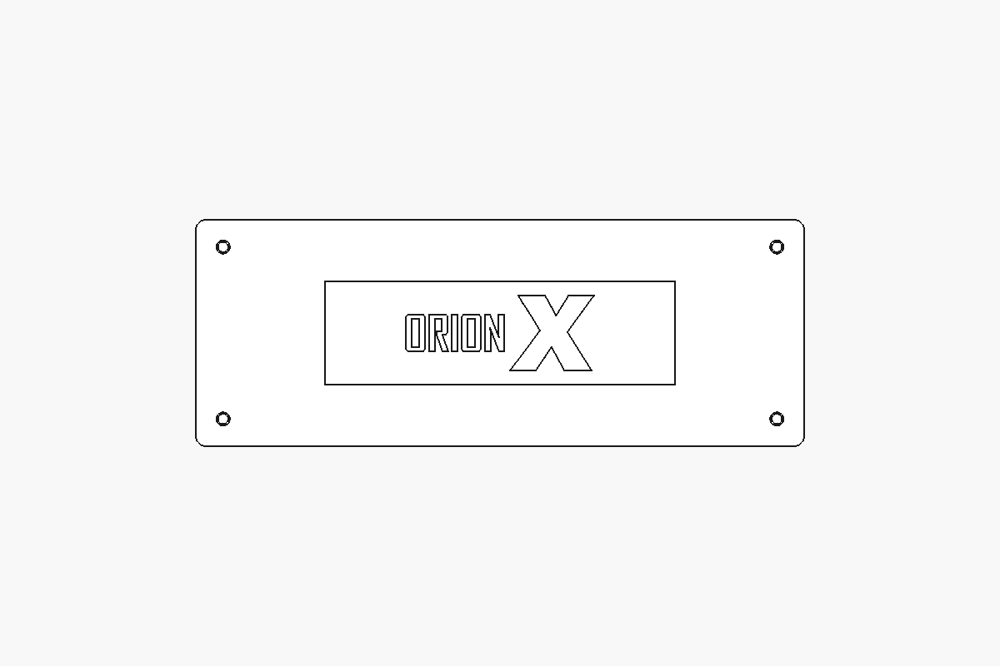
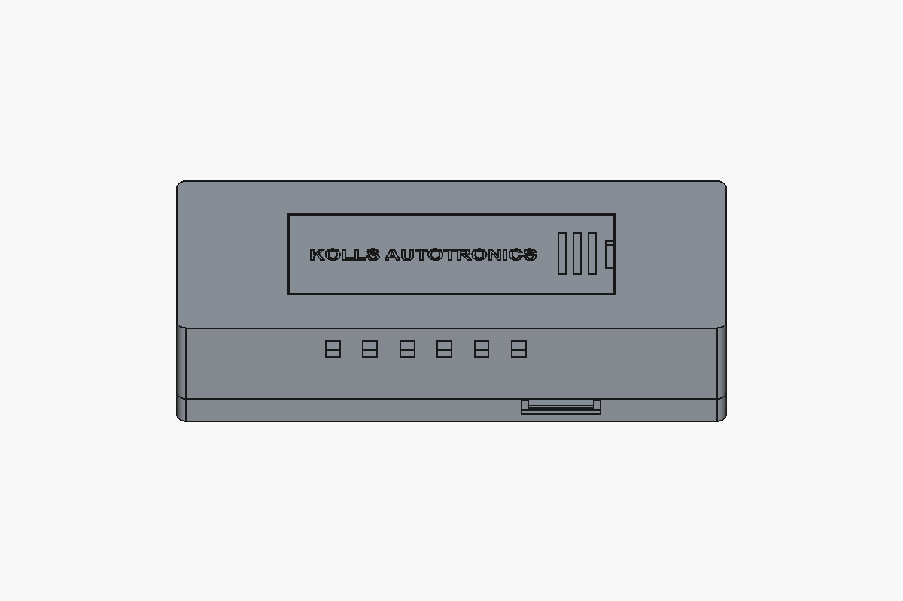

# 🚗 Orion X — Custom OBD2 Diagnostic Enclosure

> **Ultra-compact, cableless 3D-printable CAD enclosure for the Orion X edge-computing vehicle telemetry device by Kolls Autotronics.**




---

## 📐 Overview & Design Specifications

The **Orion X** is an ultra-portable OBD2 diagnostic and vehicle health tracking dongle designed to remain plugged into a vehicle's diagnostic port permanently without obstructing the driver's leg or knee.

| Specification | Dimension / Detail |
| :--- | :--- |
| **External Envelope** | **118.0 mm × 44.0 mm × 28.9 mm** |
| **Internal Cavity** | **114.0 mm × 40.0 mm × 24.9 mm** |
| **Enclosure Height** | **28.9 mm** total (Bottom Shell: 22.0 mm, Top Lid: 6.9 mm) |
| **Wall Thickness** | **2.0 mm** solid perimeter |
| **Assembly Fasteners** | 4× M2.3 × 10 mm hex socket button-head self-tapping screws |
| **Screw Bosses** | $\varnothing 5.5\text{ mm}$ outer diameter with $\varnothing 1.9\text{ mm}$ tap pilot hole |
| **Battery Access** | **100% Screwless snap-fit hatch** on bottom for fast 18650 Li-ion cell swaps |

---

## 🧩 Hardware Bill of Materials (BOM)

| # | Component | Dimensions (L×W×H) | Purpose & Design Integration |
|---|---|---|---|
| 1 | **LILYGO T-A7670G-S3 (GPS)** | 111.0 × 34.0 × 1.6 mm PCB | Main ESP32-S3 + 4G LTE/GPS MCU. Sits on continuous support rails at $Z = 21.5\text{ mm}$. |
| 2 | **18650 Li-ion Battery** | $\varnothing 18.5 \times 65.0\text{ mm}$ | Placed in the integrated surface-mount holder on the underside of the LILYGO board. |
| 3 | **OBD2 16-pin Male Connector (90° Right Elbow)** | Standard SAE J1962 (41.0 × 12.0 mm plug) | Positioned on the **118 mm front long side** ($Y = 0$) at $Z = 6.2$ to $19.2\text{ mm}$, completely beneath the PCB plane. Runs parallel to the dashboard trim. |
| 4 | **SN65HVD230 VP230 CAN Transceiver** | 28.0 × 11.0 × 3.2 mm (terminal removed) | Screw terminal block desoldered for low-profile stacking in the lower chassis chamber. |
| 5 | **Mini560 PRO 5V Buck Converter** | 33.0 × 18.0 × 5.4 mm | Converts 12V/24V vehicle power down to 5.0V for the ESP32. |
| 6 | **1N5822 Schottky Diodes (DO-27, ×2)** | $\varnothing 5.2 \times 8.5\text{ mm}$ each | Reverse-polarity protection on the vehicle 12V line. |
| 7 | **M2.3 × 10 mm Screws (×4)** | Button-head hex socket self-tapping | Clamps Top Lid to Bottom Shell into corner screw bosses. |

---

## ⚡ Key Engineering Features

### 1. Ergonomic Long-Side OBD2 Placement (Zero Leg Hits)
- Standard OBD2 dongles hang down 120–150 mm directly toward the driver's knees.
- The Orion X mounts the SAE J1962 plug on the **118 mm front long side**.
- When plugged in, the device runs horizontally along the lower dashboard trim, remaining completely out of the driver's knee path.

### 2. Lowered Connector & Continuous PCB Rails
- The OBD2 connector cutout sits at $Z = 6.2$ to $19.2\text{ mm}$ in the lower chamber.
- The LILYGO PCB rests above it at $Z = 21.5\text{ mm}$ on continuous $2.0\text{ mm}$ perimeter support shelves with no collision between the connector pins and the circuit board.

### 3. 100% Screwless Snap-Fit Battery Hatch
- Tool-less replacement of the 18650 cell without disassembling the main electronics.
- Dual front interlocking hook tabs slide under the chassis catch ledge.
- Compliant cantilever rear snap latch with an $8.0\text{ mm}$ fingernail pry notch.
- $0.2\text{ mm}$ perimeter expansion tolerance to prevent binding on FDM layer lines.

### 4. Unobstructed SIM Card Access
- Nano-SIM push-push tray slot cutout ($14.0 \times 3.5\text{ mm}$) with $45^\circ$ lead-in bevel.
- Cut across **both** `Bottom_Shell` and `Top_Lid` so closing the clamshell leaves the tray 100% accessible.

### 5. Dedicated USB-C Port
- $11.5 \times 6.0\text{ mm}$ port cutout with $45^\circ$ lead-in on the short end ($X = 0$), dedicated to the `ESP-USB` port connected to the onboard 18650 Li-ion charging circuitry.

### 6. Inscriptions & Branding
- **Top Lid**: 3D embossed **"ORION X"** badge ($68 \times 20 \times 0.6\text{ mm}$ recessed pocket). "ORION" in futuristic angular **Agency FB Bold** ($7.2\text{ mm}$) and "X" in high-performance automotive **Eras Bold** ($14.5\text{ mm}$) with a tight $1.2\text{ mm}$ emblem lockup.
- **Bottom Cover**: Clean 3D debossed **"KOLLS AUTOTRONICS"** on the exterior face ($Z = 0$), upright and readable Left-to-Right.

---

## 🖨️ 3D Printing Guidelines

| Parameter | Recommended Setting |
| :--- | :--- |
| **Material** | **PETG** or **ABS/ASA** (automotive interior heat resistance; PLA acceptable for test fit) |
| **Layer Height** | $0.20\text{ mm}$ ($0.16\text{ mm}$ optimal for clean badge text) |
| **Wall Perimeters** | **4 to 5 walls** ($0.4\text{ mm}$ nozzle) for solid screw bosses and snap latch flex |
| **Infill** | **20% to 25% Gyroid** |
| **Supports** | **None needed** when printed in recommended orientations |

### Part Print Orientations:
- **`Bottom_Shell.stl`**: Flat on build plate ($Z = 0$, open side facing up).
- **`Top_Lid.stl`**: Flat on roof face ("ORION X" badge facing down on textured PEI sheet or facing up).
- **`Battery_Cover.stl`**: Flat outer face on build plate ($Z = 0$), snap latch printing upward.

---

## 📁 Directory Files

```
hardware/enclosure/
├── OrionX_Enclosure_Final.FCStd   # Master FreeCAD 1.0 parametric CAD project
├── build_orion_x_final.py          # Python parametric CAD generator script
├── REBUILD.bat                     # One-click batch rebuild script
├── README.md                       # Enclosure documentation and print guide
├── STL/
│   ├── Bottom_Shell.stl            # Lower chassis body
│   ├── Top_Lid.stl                 # Clamshell upper lid with ORION X badge
│   └── Battery_Cover.stl           # Screwless snap-fit battery hatch
└── images/
    ├── top_view.png                # Top lid render
    ├── bottom_view.png             # Bottom hatch render
    └── axono_view.png              # 3D isometric render
```
